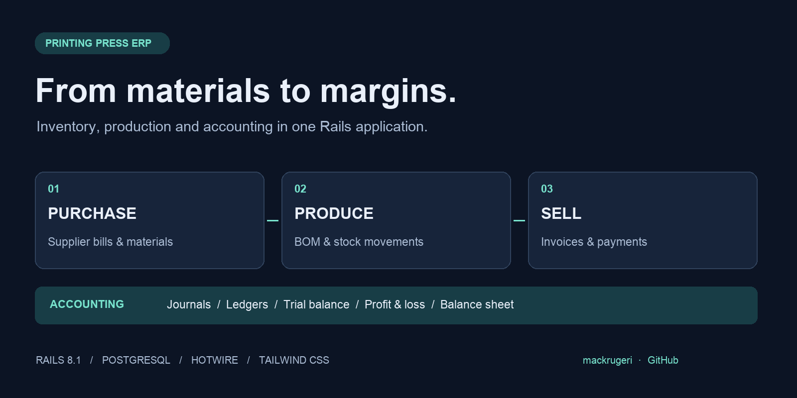
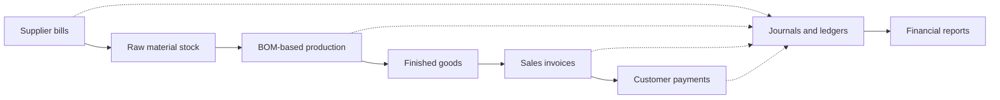

# Printing Press ERP

### From materials to margins.

A Ruby on Rails ERP project for organizing printing press and manufacturing operations: purchases, warehouse stock, bill-of-materials production, sales invoices, payments, and financial reporting.



**Rails 8.1 · PostgreSQL · Hotwire · Tailwind CSS**

[Features](#features) · [Getting started](#getting-started) · [Architecture](#architecture) · [Development status](#development-status)

## Overview

Printing businesses need to connect physical stock movements with financial records. This application brings those workflows into a single Rails codebase, with screens for operational records and services for inventory and accounting transactions.

The project is under active development. The modules below are present in the source; they are not a claim that every workflow has been verified end to end.

## Features

| Module | Capabilities in the codebase |
| --- | --- |
| Dashboard | Account-based financial summaries, recent invoices, and low-stock items |
| Inventory | Items, categories, warehouses, stock movements, and warehouse-specific quantities |
| Production | Bill-of-materials relationships, material consumption, finished-goods output, and linked accounting entries |
| Sales | Line-item invoices, calculated totals, draft/post workflows, date filtering, and CSV export |
| Purchasing | Supplier bills with line items and inventory/accounting posting logic |
| Contacts & payments | Customer/vendor records, linked accounts, and cash/bank payment recording |
| Accounting | Hierarchical chart of accounts, journals, ledger entries, and balanced-entry validation |
| Reports | Trial balance, profit and loss, and balance sheet |
| Period management | Fiscal-period and year-end closing workflows |
| Cash control | Cash tally records and reconciliation screens |

## Workflow



This diagram describes the intended relationship between the modules. Posting behavior depends on configured accounts, warehouses, and valid master data.

## Technology

- **Backend:** Ruby on Rails `~> 8.1.1`, Active Record, Puma.
- **Database:** PostgreSQL.
- **Interface:** ERB, Turbo, Stimulus, import maps, and Tailwind CSS.
- **Infrastructure:** Docker and Kamal configuration; Solid Cache, Solid Queue, and Solid Cable dependencies.
- **Development:** Minitest, Capybara, Selenium, RuboCop, Brakeman, and bundler-audit.

## Getting started

### Prerequisites

- Ruby compatible with Rails 8.1 (**Ruby 3.2 or newer**), plus Bundler. The repository's `.ruby-version` and Dockerfile currently specify `3.2.4`; confirm compatibility with the locked dependencies in your environment.
- PostgreSQL running locally, with a role permitted to create development and test databases.
- PostgreSQL client headers/libraries for the `pg` gem.
- A modern browser supported by Rails' browser gate.

### Install and create the database

From your existing local checkout:

```sh
cd ERP-System-Printing-Press
bundle install
bin/rails db:create db:migrate
```

Local defaults in `config/database.yml` are:

| Environment | Database |
| --- | --- |
| Development | `mfg_erp_development` |
| Test | `mfg_erp_test` |

The default PostgreSQL role follows your operating-system username. Adjust your local database configuration or supply `DATABASE_URL` if your environment uses a different role, host, or password. Keep credentials out of source control.

**Seed setup needs repair:** `db/seeds.rb` currently has Ruby syntax errors, begins by deleting existing data, and references `Customer`/`Vendor` classes absent from `app/models`. Do not use it on an existing database. Avoid `bin/setup` and first-run `db:prepare` until seeding is repaired, because those paths may invoke seeds. The commands above intentionally create and migrate without loading seeds.

### Start the application

```sh
bin/dev
```

Open **http://localhost:3000**. The development process runs Rails and the Tailwind watcher together.

### Configure master data

Before exercising posting workflows:

1. Create a chart of accounts with unique names and codes.
2. Create warehouses, item categories, and items.
3. Add customer/vendor contacts and link them to the appropriate accounting accounts.
4. Configure BOM records for manufactured items. A dedicated BOM editor is not exposed in the current routes.
5. Establish opening inventory and balances before recording purchases, production, sales, and payments.

Several code paths find accounts by exact name. Review the relevant model/service before configuring accounts: invoice posting uses `Sales Income`; purchase posting uses `Inventory Asset` and `Accounts Payable`; manufacturing uses `Raw Materials` and `Finished Goods`. Dashboard summaries also reference `Cash in Hand` and `Finished Goods Inventory`.

## Architecture

```text
app/
├── controllers/    Request handling and workflow orchestration
├── models/         Business records, validations, balances, and posting logic
├── services/       Accounting, manufacturing, production, and closing operations
├── views/          ERB screens, forms, reports, and shared components
└── javascript/     Stimulus controllers and client-side invoice calculations
config/            Routes, database settings, and deployment configuration
db/                Schema, migrations, and seed script
test/              Minitest tests and fixtures
```

Key domain relationships:

- **Items → stock transactions → warehouses:** quantities are derived from stock movements.
- **Finished items → BOM items → materials:** manufacturing records consumption and output.
- **Invoices/purchase bills → line items → contacts:** commercial documents connect items with customers and suppliers.
- **Journal entries → ledger entries → accounts:** debit/credit entries feed balances and reports.

`JournalEntry` validates that entries balance and are nonzero. The invoice posting flow wraps stock and ledger changes in a transaction, while posted invoices are protected from editing through the controller.

## Development checks

With dependencies installed and a separate test database configured:

```sh
bin/rails db:test:prepare
bin/rails test
bin/rails test:system
bin/rubocop
bin/brakeman --no-pager
bin/bundler-audit
bin/importmap audit
```

System tests require a compatible browser and driver. GitHub Actions defines test, system-test, lint, and security-scan jobs. Their presence does not imply that the current branch passes; validate locally before relying on a workflow.

## Development status

This is a work-in-progress ERP implementation. Current areas needing attention include:

- **Bootstrap data:** repair seed syntax, class references, duplicate records, and account configuration before enabling automatic seeding.
- **Consistent accounting conventions:** align exact account names and account types across dashboards, posting services, and year-end closing. The closing service queries `Revenue`, while the account model currently accepts `Income`.
- **Posting consolidation:** overlapping accounting and production services need alignment and integration coverage.
- **Cost accounting:** invoice COGS ledger entries are commented out; do not assume sales posting recognizes cost of goods sold.
- **Access control:** authentication and role-based authorization are not implemented in the inspected application controller/routes.
- **Test coverage:** the test suite is small and includes scaffold-style tests; expand coverage for inventory, balanced postings, payments, and fiscal closing.

These limitations should be resolved and the financial workflows independently verified before operational use.

## Deployment

The repository contains a production Dockerfile and Kamal configuration. Treat them as deployment starting points. Configure application secrets, PostgreSQL access, and the production primary/cache/queue/cable databases for your environment. The production database configuration references `MFG_ERP_DATABASE_PASSWORD`.

No hosted demo or production deployment is claimed by this README.

## Contributing

Focused contributions are welcome: describe the problem, keep changes scoped, and include relevant checks. For financial or stock changes, document the expected ledger entries and quantity movements so the behavior can be reviewed.

## Author

Built by [mackrugeri](https://github.com/mackrugeri).

## License

No license file is currently included. Add an explicit license before offering the project for reuse or redistribution.
